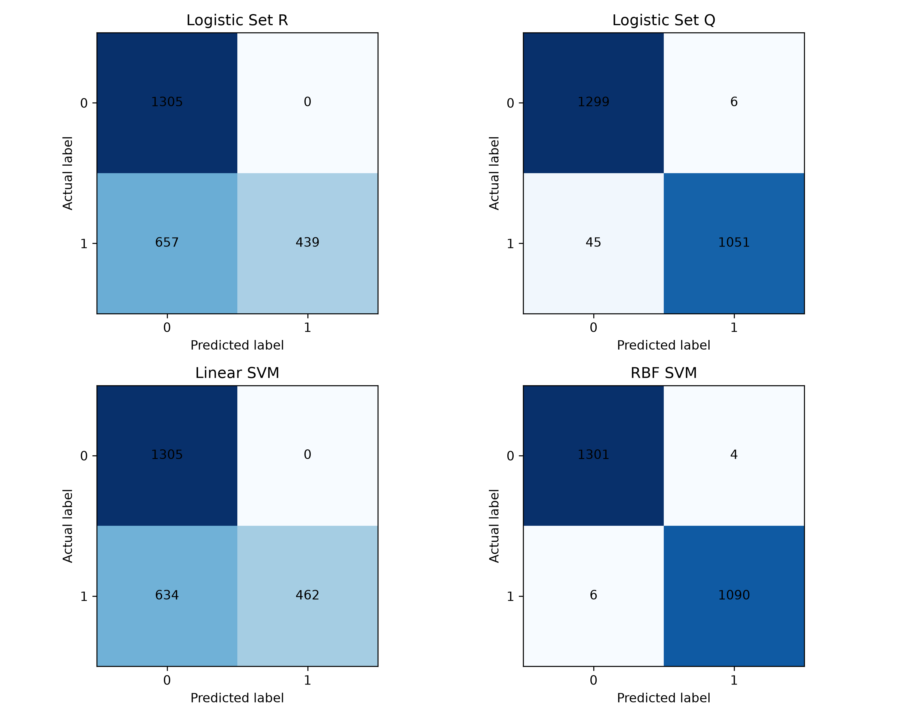
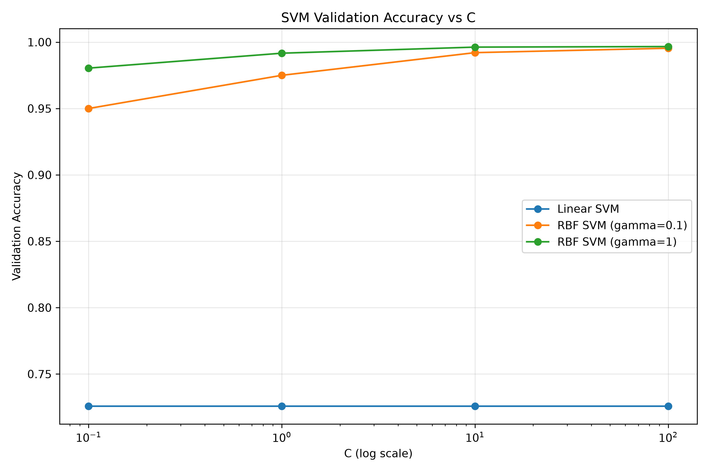
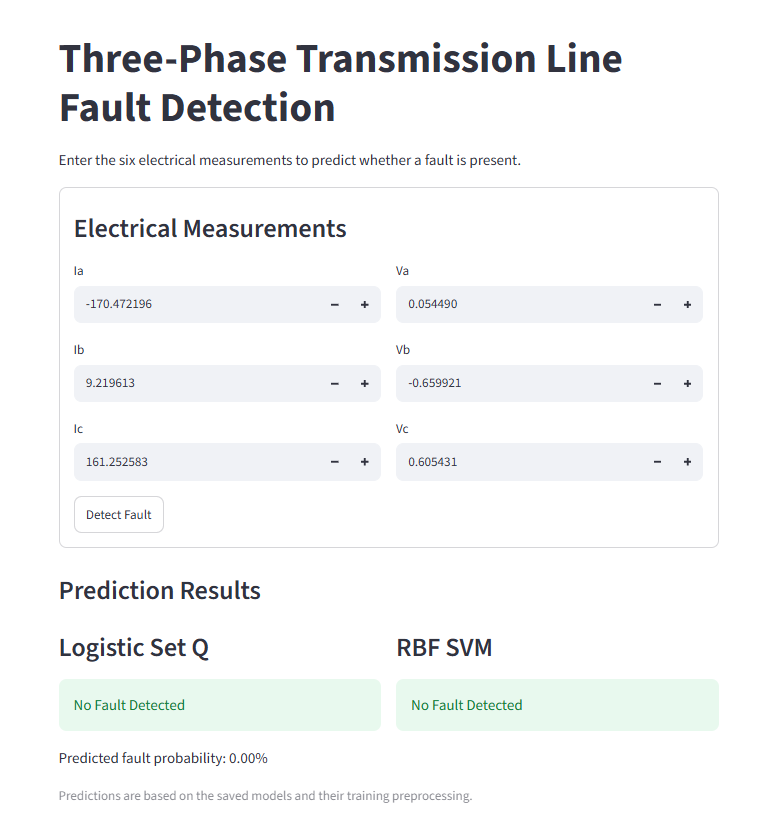
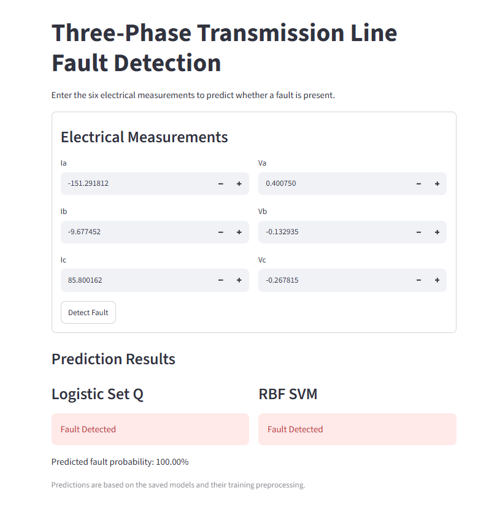

# Three-Phase Transmission Line Fault Detection

## Project Overview

This project applies machine learning to detect faults in a three-phase transmission line using three-phase current and voltage measurements. It compares Logistic Regression and Support Vector Machine (SVM) classifiers and provides a Streamlit interface for predictions.

The input features are:

- `Ia`
- `Ib`
- `Ic`
- `Va`
- `Vb`
- `Vc`

The target variable is `fault`, where `0` indicates no fault and `1` indicates a fault.

## Models

Four models are evaluated:

1. Logistic Regression — Set R
2. Logistic Regression — Set Q
3. Linear SVM
4. RBF SVM

Set Q includes squared input features. The SVM models use feature standardization based on the training data.

## Dataset and Data Splitting

The dataset contains 12,001 samples and six input features after removing the two extra unnamed columns. The data is divided into training, validation, and test sets using the assignment's specified random permutation with seed `42`:

- Training: 7,200 samples (60%)
- Validation: 2,400 samples (20%)
- Testing: 2,401 samples (remaining samples)

## Test Results

| Model | Accuracy | Precision | Recall | F1-score | Missed Faults | False Alarms |
|---|---:|---:|---:|---:|---:|---:|
| Logistic Regression — Set R | 72.64% | 100.00% | 40.05% | 57.20% | 657 | 0 |
| Logistic Regression — Set Q | 97.88% | 99.43% | 95.89% | 97.63% | 45 | 6 |
| Linear SVM | 73.59% | 100.00% | 42.15% | 59.31% | 634 | 0 |
| RBF SVM | 99.58% | 99.63% | 99.45% | 99.54% | 6 | 4 |

The RBF SVM achieved the highest test accuracy among the four evaluated models. Its test confusion matrix contains 1,301 true negatives, 4 false positives, 6 false negatives, and 1,090 true positives.

## Confusion Matrices



## SVM Validation Accuracy



## Frontend Application

The Streamlit application accepts the six electrical measurements and displays predictions from Logistic Regression Set Q and the RBF SVM.

### No-Fault Sample Prediction



### Fault Sample Prediction



## Project Structure

```text
Assignment_2/
├── data/
│   └── detect_dataset.csv
├── src/
│   ├── load_data.py
│   ├── prepare.py
│   ├── eda.py
│   ├── logistic.py
│   ├── metrics.py
│   ├── train_logistic.py
│   ├── train_svm.py
│   └── test_models.py
├── results/
│   ├── figures/
│   ├── models/
│   ├── tables/
│   ├── logistic_models.npz
│   └── analysis.md
├── app/
│   └── app.py
└── README.md
```

## Installation

Install the required Python packages:

```bash
python -m pip install numpy pandas matplotlib joblib scikit-learn streamlit
```

## Running the Project

From the project root, run the training and evaluation scripts as required:

```bash
python src/train_logistic.py
python src/train_svm.py
python src/test_models.py
```

Start the frontend application with:

```bash
python -m streamlit run app/app.py
```

The app opens in a browser. Enter values for `Ia`, `Ib`, `Ic`, `Va`, `Vb`, and `Vc`, then select **Detect Fault** to view predictions from Logistic Regression Set Q and the RBF SVM.

## Conclusion

The test results show that the RBF SVM performed best among the four evaluated models, with 99.58% accuracy on the held-out test set. It missed 6 faults and produced 4 false alarms. The frontend demonstrates the use of the saved models for classifying input measurements. These results describe performance on the available dataset and do not alone establish readiness for real-world deployment.
